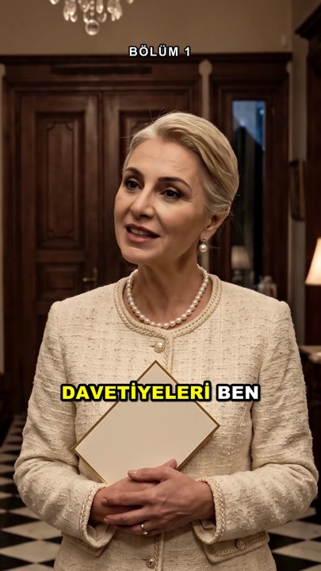

# Doğukan Short Drama

**Claude Code + Higgsfield ile Türkçe AI dikey mikro dizi (short-drama) üretim şablonu.**

Claude fikirden yayına kadar seni adım adım götürür: fikir puanlama, sezon planı, senaryo, karakterler,
klipler, kurgu, altyazı.

## En kolay yol

Hiçbir şey bilmene gerek yok. Claude soru sorarak kurar, sonra ilk dizine götürür.

1. **Claude Code'u kur:** https://claude.com/claude-code (masaüstü uygulaması ya da terminal sürümü).
2. **Boş bir klasörde Claude Code'u aç.** Windows'ta yolunda Türkçe harf ya da boşluk olmayan kısa bir klasör
   seç (ör. `C:\drama`).
3. **Şunu yaz:**
   ```
   https://github.com/xdoko000-droid/dogukan-short-drama reposunu kur
   ```
   Claude repoyu klonlar ve `/kur` akışını başlatır: Python, ffmpeg, Git, paketler ve Higgsfield girişi.
   Her kurulumdan önce sana sorar. Tarayıcıda giriş gibi senin yapman gerekenleri adım adım söyler.
4. Kurulum bitince Claude "İlk dizini yapalım mı?" diye sorar. Ya da istediğin zaman `/ilk-dizi` yaz.

Repoyu zaten klonladıysan klasörde Claude Code'u aç ve `/kur` yaz (ya da sadece "kur").

<!-- SPONSOR_LINK -->
**Higgsfield hesabın yok mu?** Buradan kayıt olabilirsin: https://higgsfield.ai/s/higgsfield-mcp-general-yt-dogukanlive-CTCNCG
> Reklam / sponsorlu bağlantı: Bu repo ve tanıtım videosu Higgsfield iş birliğiyle hazırlandı. Bağlantı takip kodu içerir.

> İçerikler kurgudur ve AI ile üretilir. Gerçek kişilere benzeyen yüz kullanılmaz.

---

## Ne yapar?

- **Fikir:** 6 ölçütle puanlar; Türk izleyicisine uygun 15 özgün fikirlik banka içerir.
- **Sezon ve bölüm:** 8–10 bölümlük plan, kancalı ~60 sn bölüm yapısı, cliffhanger haritası.
- **Karakter tutarlılığı:** yüz → kıyafet → karakter sayfası → mekân; her varlığa sabit ad (`@Defne`).
- **Klip promptları:** Veo 3.1 Lite (ucuz, tek çekim) ve Seedance 2.5 (çok kesmeli) için hazır kalıplar.
- **Maliyet kontrolü:** her ücretli üretimden önce kredi tahmini ve onay; toplam tavan.
- **Kurgu:** hızlı kesme, punch-in, BOOM/WHOOSH/RISER efektleri, kelime kelime sarı altyazı, −15 LUFS.

Üretim Higgsfield üzerinden yapılır (MCP ya da CLI). Kurgu yerel Python betikleriyle, ücretsiz.

## 3 bütçe tarifi

Higgsfield kredisiyle, bölüm başı ~60 sn. Fiyatlar **22 Eki 2026** tarihlidir, değişebilir.

| Tarif | Nasıl | Bölüm başı | 30 bölüm |
|---|---|---|---|
| **Ekonomik** | Veo 3.1 Lite, 4/6/8 sn klipler, başlangıç karesiyle | ~140 kr | ~4.200 |
| **Dengeli** | Kanca, yüzleşme ve cliffhanger için ~30 sn Seedance 2.5 720p, gerisi Veo Lite | ~375 kr | ~11.000 |
| **Premium** | Tamamı Seedance 2.5 720p | ~950 kr | ~29.000 |

Ayrıntı: [docs/02-maliyet.md](docs/02-maliyet.md)

---

## Elle kurulum

`/kur` akışını kullanmak istemezsen adımlar aşağıda.

Gerekenler:
- Claude Code
- Python 3.10 ya da üstü
- ffmpeg
- Higgsfield hesabı (kredili)
- (Yedek yol için) Node.js

### Windows

PowerShell'i aç.

1. **Git** (Claude Code Windows'ta Git for Windows ister; klonlamak için de gerekir):
   ```
   winget install Git.Git
   ```
   PowerShell'i kapatıp aç. Kontrol: `git --version`
2. **Claude Code** — https://claude.com/claude-code adresindeki Windows kurulum adımlarını izle. Kontrol:
   ```
   claude --version
   ```
3. **Python 3.10+** — https://www.python.org/downloads/ adresinden kur. Kurulumda
   **"Add python.exe to PATH"** kutusunu işaretle. Ya da:
   ```
   winget install Python.Python.3.12
   ```
   Kontrol:
   ```
   py --version
   ```
4. **ffmpeg**:
   ```
   winget install Gyan.FFmpeg
   ```
   PowerShell'i kapatıp aç. Kontrol: `ffmpeg -version`
5. **Repoyu klonla ve paketleri kur** (sanal ortam önerilir):
   ```
   git clone https://github.com/xdoko000-droid/dogukan-short-drama.git
   cd dogukan-short-drama
   py -m venv .venv
   .venv\Scripts\Activate.ps1
   py -m pip install -r requirements.txt
   ```
   `Activate.ps1` "betik çalıştırma devre dışı" hatası verirse:
   `Set-ExecutionPolicy -Scope CurrentUser RemoteSigned`, sonra yeniden dene. Ya da activate etmeden
   doğrudan çalıştır: `.venv\Scripts\python.exe -m pip install -r requirements.txt`
6. **Higgsfield MCP'yi bağla** — aşağıdaki bölüme bak.

### Mac

Terminal'i aç.

1. **Claude Code** — https://claude.com/claude-code adresindeki kurulum adımlarını izle. Kontrol: `claude --version`
2. **Homebrew** yoksa https://brew.sh adresindeki tek satırlık komutla kur.
3. **Python ve ffmpeg**:
   ```
   brew install python ffmpeg
   ```
4. **Repoyu klonla ve paketleri kur** (sanal ortam önerilir):
   ```
   git clone https://github.com/xdoko000-droid/dogukan-short-drama.git
   cd dogukan-short-drama
   python3 -m venv .venv
   source .venv/bin/activate
   python3 -m pip install -r requirements.txt
   ```
5. **Higgsfield MCP'yi bağla** — aşağıdaki bölüme bak.

> Python 3.10+ gerekir. Mac'in sistem Python'u 3.9 olabilir (`python3 --version`). Homebrew kurmak istemiyorsan
> [uv](https://docs.astral.sh/uv/getting-started/installation/) ile: `uv python install 3.12`, sonra
> `uv venv --python 3.12 .venv` ve `uv pip install --python .venv/bin/python -r requirements.txt`.
> Ya da https://www.python.org/downloads/ yükleyicisi, ardından `python3.12 -m venv .venv`. Eski `.venv`'i silip yeniden oluştur.

> Not: Homebrew'un ffmpeg'i altyazı gömmeyi (libass) desteklemeyebilir. `requirements.txt` içindeki
> `imageio-ffmpeg` paketi destekleyen bir ffmpeg getirir; `python3 scripts/doctor.py` doğru olanı seçer.

### Higgsfield MCP'yi bağla

Repo kökünde hazır bir `.mcp.json` var (sunucu: `https://mcp.higgsfield.ai/mcp`).

1. Repo klasöründe Claude Code'u başlat:
   ```
   claude
   ```
2. Projedeki `higgsfield` MCP sunucusunu **onayla**.
3. Claude Code içinde `/mcp` yaz → `higgsfield` → **Authenticate** → tarayıcıda Higgsfield hesabınla giriş yap.

Elle eklemek istersen:
```
claude mcp add --transport http higgsfield https://mcp.higgsfield.ai/mcp
```
Yedek yol (CLI), Windows notları ve sorun giderme: [docs/05-higgsfield-mcp-kurulum.md](docs/05-higgsfield-mcp-kurulum.md)

> Claude masaüstü/web uygulamasında da aynı bağlantı kurulabilir: **Settings → Connectors → +** →
> Ad `Higgsfield`, URL `https://mcp.higgsfield.ai/mcp` → **Add** → giriş yap. Ama bu repo dosya ve betik
> kullandığı için asıl çalışma yeri **Claude Code**'dur.

### Kontrol

```
py scripts/doctor.py          # Windows
python3 scripts/doctor.py     # Mac
```
Her satırda ✓ varsa hazırsın. (Sanal ortam etkinse iki platformda da `python` yeter.)

### Deneme

Kurguyu kredi harcamadan dene. Bu adım ücretsizdir, onay gerektirmez; Higgsfield'a dokunmaz
(yalnız yerel ffmpeg ile renkli test klipleri üretip örnek kurguyu çalıştırır):
```
python scripts/deneme.py
```
Çıktı: `examples/output/bolum.mp4`. (Aynısı elle: `python scripts/ornek_klip.py` ardından
`python scripts/kurgu.py examples/kurgu-ornek.json`.) Altyazı modeli ilk çalıştırmada ücretsiz indirilir;
internet yoksa altyazı tahmini zamanlamayla yazılır.

---

## 5 dakikada ilk bölüm

1. Repo klasöründe `claude` yaz.
2. Şunu söyle:
   ```
   Bir mini dizi yapalım. Fikrim yok, fikir bankasından en iyi 3'ünü öner.
   ```
3. Claude ortamı kontrol eder, 3 fikir önerir. Birini seç.
4. Sezon planını ve 1. bölüm senaryosunu onayla.
5. Claude karakterleri ve mekânı üretmeden önce **maliyeti gösterir**. "Evet" de.
6. Yüz seçeneklerinden birini seç. Karakter sayfaları hazırlanır.
7. Klip listesini ve toplam krediyi onayla. Claude en fazla 4 işi aynı anda gönderir.
8. Claude kurguyu yapar, kontrol karelerini gösterir. Son dosya:
   `uretim/<seri-adi>/bolumler/bolum-01/bolum-01.mp4`
9. Yayın başlığı, açıklama ve hashtag'leri al. TikTok'ta **AI etiketini aç**.

Kendi fikrin varsa 2. adımda onu yaz: "Kına gecesinde damadın eski nişanlısı gelir. Bunu 8 bölüm yapalım."

Üretim süresi kredine, kuyruk yoğunluğuna ve onay hızına bağlıdır. İlk bölüm genelde birkaç saat sürer.

## Örnek

[examples/cifte-davetiye/](examples/cifte-davetiye/) — "Çifte Davetiye": düğüne üç gün kala gelin,
ikinci davetiyede gelin olarak en yakın arkadaşının adını bulur. Sezon planı, 1. bölüm senaryosu,
kullanılan gerçek promptlar ve kareler.

| Kanca | Darbe | Cliffhanger |
|---|---|---|
|  |  |  |

## Belgeler

| Belge | İçerik |
|---|---|
| [docs/01-yontem.md](docs/01-yontem.md) | Yöntem: fikir, sezon, bölüm yapısı, varlıklar, sabitler, klipler, kurgu |
| [docs/02-maliyet.md](docs/02-maliyet.md) | Fiyatlar, 3 tarif, tasarruf |
| [docs/03-dersler.md](docs/03-dersler.md) | Gerçek üretimden dersler |
| [docs/04-tiktok-yayin.md](docs/04-tiktok-yayin.md) | Yayın metni ve kuralları |
| [docs/05-higgsfield-mcp-kurulum.md](docs/05-higgsfield-mcp-kurulum.md) | MCP ve CLI kurulumu |
| [templates/](templates/) | Doldurulacak şablonlar ve prompt kalıpları |

## Kurallar

- Her ücretli üretimden önce maliyet gösterilir, onayın alınır. Toplam tavan belirlenir.
- Aynı anda en fazla 4 iş; çift gönderim yok.
- Gerçek kişiye benzeyen yüz yok.
- TikTok'ta AI etiketi açık.
- Bu repo gelir ya da kazanç vaat etmez.

## Kaynaklar

Bazı teknikler (fikir puanlama, dört parçalı bölüm yapısı, karakter sayfası kuralları, klip promptu
blok yapısı) Higgsfield'ın short-drama rehberinden esinlenmiştir:
https://higgsfield.ai/@adilinthewildtempo/blogs/how-to-make-ai-short-drama
Metinler kopyalanmamıştır; teknikler kendi deneyimimizle sınanıp kendi cümlelerimizle yazılmıştır.

## Lisans

- Kod (`scripts/` ve diğer kaynak kod): [MIT](LICENSE)
- Belgeler, şablonlar, örnekler ve skill metinleri: [CC BY 4.0](LICENSE-docs)

Higgsfield, Claude, Veo, Seedance ve diğer adlar sahiplerinin markalarıdır. Bu repo onlarla bağlantılı değildir.

---

## English

**Doğukan Short Drama** is a template for producing Turkish vertical micro-dramas (9:16, ~60 s episodes)
with Claude Code and Higgsfield (via MCP or CLI).

### Easiest way

1. Install Claude Code: https://claude.com/claude-code
2. Open Claude Code in an empty folder (on Windows, pick a short path without non-ASCII characters or spaces, e.g. `C:\drama`).
3. Type: `Install the repo https://github.com/xdoko000-droid/dogukan-short-drama`
   Claude clones it and runs the `/kur` setup wizard (Python, ffmpeg, Git, packages, Higgsfield login),
   asking before every install. Then run `/ilk-dizi` for a guided first series.

No Higgsfield account yet? Sign up here: https://higgsfield.ai/s/higgsfield-mcp-general-yt-dogukanlive-CTCNCG
(sponsored link — this kit and its video were made in partnership with Higgsfield; the link contains a tracking code).

### Manual setup

1. Install Git (required by Claude Code on Windows), Claude Code, Python 3.10+, ffmpeg.
2. `git clone https://github.com/xdoko000-droid/dogukan-short-drama.git`, then inside the folder create a virtual
   environment (`.venv`) and run `pip install -r requirements.txt`.
3. Open the folder in Claude Code (`claude`), approve the bundled `higgsfield` MCP server
   (`https://mcp.higgsfield.ai/mcp`), run `/mcp` → Authenticate.
   The same connector also works in the Claude desktop/web app (Settings → Connectors → + → URL above),
   but this kit runs local files and scripts, so Claude Code is the main place to work.
4. Say: "Let's make a mini drama." Claude scores ideas, plans the season, writes the episode,
   builds consistent characters, writes Veo 3.1 Lite / Seedance 2.5 prompts, shows the credit cost
   before every paid generation, and edits the final cut with word-by-word captions and sound design.

Budget recipes (Higgsfield credits, prices as of 22 Oct 2026): Economy ~140 / episode,
Balanced ~375, Premium ~950. The project skill lives in `.claude/skills/short-drama-tr/`;
setup and first-series flows in `.claude/commands/`. Docs are in Turkish.
Code: MIT. Docs: CC BY 4.0. © 2026 Doğukan Doğan (DogukanLive). No income claims.
